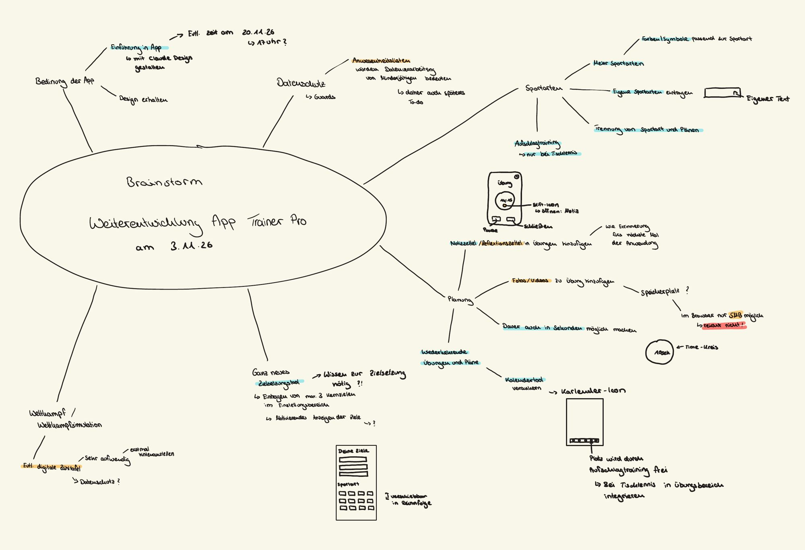

# I.1 Brainstorm

> **Status: abgeschlossen am 03.11.2026** (Wechsel in I.2 Planning auf Anweisung der Entwickler:in).
> Ergebnis ist die handgezeichnete Mindmap der Entwickler:in; Claudes Vorschläge (siehe Git-Historie dieser
> Datei, Commit `fc2e550`) dienten als Input.

## Mindmap der Entwickler:in (03.11.2026)

Original: [assets/brainstorming-2026-11-03.pdf](assets/brainstorming-2026-11-03.pdf)

### Abschrift (Markierungen: 🟦 = blau, 🟧 = orange, 🟥 = rot hervorgehoben; Bedeutung siehe offene Punkte)

**Zentrum:** Brainstorm – Weiterentwicklung App Trainer Pro am 3.11.26

- **Bedienung der App**
  - 🟦 Einführung in App → mit Claude Design gestalten → evtl. Zeit am 20.11.26, 17 Uhr?
  - Design erhalten
- **Datenschutz** → Guards
  - 🟧 Anwesenheitslisten würden Datenverarbeitung von Minderjährigen bedeuten → daher späteres To-do
- **Sportarten**
  - 🟦 Mehr Sportarten → 🟦 Farben/Symbole passend zur Sportart
  - 🟦 Eigene Sportarten eintragen → Eingabefeld „Eigener Text“
  - 🟦 Trennung von Sportart und Plänen
  - 🟦 Aufschlagtraining → nur bei Tischtennis
- **Planung**
  - 🟦 Notizzettel / 🟧 Reflexionszettel in Übungen hinzufügen → wie eine Erinnerung fürs nächste Mal der Anwendung
    - *Skizze:* Übungs-Screen mit Timer; Stift-Icon im Timer öffnet die Notiz; Buttons „Pause“ und „Schließen“
  - 🟧 Fotos/Videos zu Übung hinzufügen → Speicherplatz? → im Browser nur 🟧 5 MB möglich → 🟥 reicht nicht!
  - 🟦 Dauer auch in Sekunden möglich machen → *Skizze:* Time-Kreis „10 sek“
  - 🟦 Wiederkehrende Übungen und Pläne → 🟦 Kalendertool verankern → Kalender-Icon
    - *Skizze:* Kalender-Icon in der unteren Navigationsleiste; der Platz wird durch das Aufschlagtraining frei → bei Tischtennis in den Übungsbereich integrieren
- **Ganz neues 🟦 Zielsetzungstool** → Wissen zur Zielsetzung nötig?!
  - Eintragen von max. 3 Kernzielen im Einstellungsbereich
  - Motivierendes Anzeigen der Ziele → ?
  - *Skizze:* Screen „Deine Ziele“ (3 Felder), darunter „Sportart“ als Kachelraster, verschiebbar in der Reihenfolge
- **Wettkampf / Wettkampfsimulation**
  - 🟧 Evtl. digitale Zähltafel → sehr aufwendig → erst mal hintanstellen; Datenschutz?

### Bezug zum Feedback
| Mindmap-Punkt | Feedback |
|---|---|
| Einführung in App | B2 |
| Design erhalten | A3 |
| Anwesenheitslisten (später) | B1 |
| Mehr/eigene Sportarten, Farben/Symbole, Trennung, Aufschlagtraining | A1, A2, A6, A7, B5 |
| Notizzettel/Reflexion | B4 |
| Fotos/Videos | B3, B5 |
| Dauer in Sekunden | B3 |
| Wiederkehrende Übungen/Pläne, Kalender | A6, A7 |
| Zielsetzungstool | neu (eigene Idee) |
| Zähltafel / Wettkampf (später) | B4 |
| nicht aufgenommen: gemeinsame Pläne, Übungs-Workshop, USP | A8, B5, A5 |

### Offene Punkte (bewusst ins Planning mitgenommen)
- Bedeutung der Farbmarkierungen – **geklärt 03.11.2026:** 🟦 blau = umsetzen, 🟧 orange = in dieser Phase der Weiterentwicklung nicht relevant
- Einsatzbereich: Nutzung eher zu Hause, in der Halle oder beides – *offen*
- 3 nicht sichtbare Antworten der Gruppe A – *offen*
- Zuordnung Screenshot 1 = Gruppe A, Screenshot 2 = Gruppe B – *zu bestätigen*

## 1. Ist-Zustand (Version vom 27.08.2026)
- **Übungen:** Erstellen von Einzelübungen (Name, Beschreibung, Ziel, Dauer, Schwierigkeitsgrad).
- **Trainingspläne:** Übungen zu einem Plan zusammenfügen und sortieren; Detailansicht mit Timer; Eintrag in einen Terminkalender.
- **Sportart:** in den Einstellungen wählbar (im Code: `Tischtennis`, `Beach Volleyball`), wirkt sich auf die Icons aus.
- **Aufschlagtraining:** fest auf Tischtennis ausgerichtet, passt sich nicht an die Sportart an.
- **Statistiken**, Onboarding, lokales Konto; Daten in `localStorage`.

## 2. Befunde der Erstbefragung (12.10.2026, ISO/IEC 25010, Gruppen A n=15 und B n=5)
- Technische Qualität (Leistungseffizienz, Zuverlässigkeit): sehr gut (Gruppe B: Median 5, SD 0).
- Benutzbarkeit: hoch, aber mit Streuung → Verbesserungspotenzial.
- Funktionale Eignung: schwächster Bereich (Gruppe B: Mittelwert 3,60; teils Median < 4).
- Design: stark streuende Bewertung, offene Rückmeldungen beachten.

## 2a. Offenes Feedback der Erstbefragung („Sonstiges: Gibt es etwas, das du an der App verbessern würdest?“)

Wörtlich sinngemäß zusammengefasst, ohne Personenbezug. Gruppe A: 11 Antworten (8 auf dem Screenshot sichtbar),
Gruppe B: 5 Antworten. Kürzel für Verweise: A1–A8, B1–B5.

| # | Gruppe | Rückmeldung | Code-Befund |
|---|---|---|---|
| A1 | A | Individuelles Design (Symbole etc.); Trainingspläne und Übungen sollen sich beim Wechsel der Sportart zurücksetzen | Übungen/Pläne haben kein Sportart-Feld (`src/types.ts`) |
| A2 | A | „Gym“ als Sportart fehlt, sonst kein Trainingsplan möglich | nur Tischtennis, Beach Volleyball |
| A3 | A | Anordnung und Design gut gelungen | – |
| A4 | A | keine Verbesserung („nö“) | – |
| A5 | A | Was macht die App besser als andere? Es fehlt ein USP für den offenen Markt | – |
| A6 | A | Mitteilungen, mehr Sportarten | – |
| A7 | A | Erinnerungen, Benachrichtigungen, mehr Sportarten, automatische Wiederkehr | Plan hat nur ein einzelnes Datum |
| A8 | A | Gemeinsamer Trainingsplan mit mehreren Accounts | nur lokales Konto, kein Backend |
| B1 | B | Anwesenheitslisten (wer fehlt zu oft) | – |
| B2 | B | Einleitung in die Funktionen der App | Onboarding mit 3 Seiten vorhanden |
| B3 | B | Übungen auch nur wenige Sekunden lang; Fotos als Beschreibung | Dauer nur in Minuten (`durationMinutes`) |
| B4 | B | Pool vorgefertigter Übungen; Liste der Trainierenden mit individuellen Statistiken (z. B. Aufschläge); digitale Zähltafel; Notizen zu Trainingsplänen; Turnierfunktion | – |
| B5 | B | Eigene Fotos/Videos zu Übungen; „Workshop“, um Übungen anderer Nutzer zu nutzen; Aufschlagtraining bleibt bei Fußball sichtbar → sportartspezifisch machen (z. B. Freistoßtraining) | Aufschlagtraining fest auf Tischtennis |

**Häufigste Themen:** mehr Sportarten / sportartabhängige App (A1, A2, A6, A7, B5) · Erinnerungen und
Wiederkehr (A6, A7) · Medien zu Übungen (B3, B5) · Organisation der Trainingsgruppe (B1, B4) ·
Zusammenarbeit/Teilen (A8, B5).

## 3. Anforderungen
Vorgabe der Entwickler:in (03.11.2026): Die App wird von einer Tischtennis-App zu einer App **für alle
Sportarten** weiterentwickelt, die Trainer:innen besonders bei **Planung und Organisation** entlastet.
Das **Feedback der Testgruppen hat die höchste Priorität**.

- App für alle Sportarten; alle Bereiche (inkl. Spezialtraining) sportartabhängig (A1, A2, A6, A7, B5).
- Funktionale Eignung verbessern, abgeleitet aus Abschnitt 2a (Planung, Organisation, Medien).
- Design beibehalten (A3), aber Symbole/Farben je Sportart (A1).

## 4. Einsatzbereich
Vereinssport; Übungsleiter:innen verschiedener Sportarten; Hauptzielgruppe 15–25 Jahre.

## 5. Skizze der Screens und ersten Features
*offen – bitte ergänzen (z. B. Foto/Scan der Skizze unter `docs/ifcm/assets/` ablegen).*

## 6. Parkplatz (weitere Ideen)
*offen*
