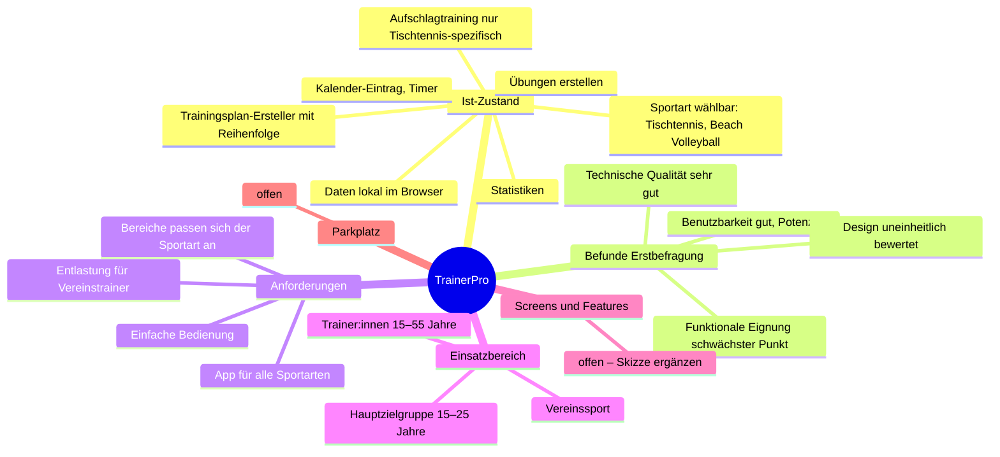

# I.1 Brainstorm

> **Status: Entwurf** – übernommen aus der BLL (Kap. 2.1, 2.4) und dem Code-Stand (Commit `f3314ea`,
> 12.08.2026). Bitte prüfen, korrigieren, ergänzen. Erst nach Bestätigung gilt die Sub-Phase als abgeschlossen.

## Mindmap

## 1. Ist-Zustand (Version vom 27.08.2026)
- **Übungen:** Erstellen von Einzelübungen (Name, Beschreibung, Ziel, Dauer, Schwierigkeitsgrad).
- **Trainingspläne:** Übungen zu einem Plan zusammenfügen und sortieren; Detailansicht mit Timer; Eintrag in einen Terminkalender.
- **Sportart:** in den Einstellungen wählbar (im Code: `Tischtennis`, `Beach Volleyball`), wirkt sich auf die Icons aus.
- **Aufschlagtraining:** fest auf Tischtennis ausgerichtet, passt sich nicht an die Sportart an.
- **Statistiken**, Onboarding, lokales Konto; Daten in `localStorage`.

## 2. Befunde der Erstbefragung (12.10.2026, ISO/IEC 25010, Gruppen A n=15 und B n=5)
- Technische Qualität (Leistungseffizienz, Zuverlässigkeit): sehr gut (Gruppe B: Median 5, SD 0).
- Benutzbarkeit: hoch, aber mit Streuung → Verbesserungspotenzial.
- Funktionale Eignung: schwächster Bereich (Gruppe B: Mittelwert 3,60; teils Median < 4).
- Design: stark streuende Bewertung, offene Rückmeldungen beachten.

## 3. Anforderungen
- App für **alle Sportarten**, nicht nur Tischtennis; alle Bereiche (inkl. Aufschlag-/Techniktraining) sportartabhängig.
- Funktionale Eignung verbessern (konkrete Wünsche aus offenem Feedback: *offen – bitte ergänzen*).
- Design an den genannten Stellen überarbeiten (*offen – bitte ergänzen*).

## 4. Einsatzbereich
Vereinssport; Übungsleiter:innen verschiedener Sportarten; Hauptzielgruppe 15–25 Jahre.

## 5. Skizze der Screens und ersten Features
*offen – bitte ergänzen (z. B. Foto/Scan der Skizze unter `docs/ifcm/assets/` ablegen).*

## 6. Parkplatz (weitere Ideen)
*offen*
