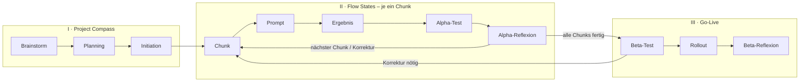

# IFCM-Prozessprotokoll – TrainerPro

Die Weiterentwicklung von TrainerPro folgt dem **Intelligence-Flow-Compass-Modell (IFCM)** aus der
Besonderen Lernleistung (Kap. 3.6–3.10). Dieser Ordner ist das vollständige, nachvollziehbare Protokoll
des Prozesses (Wert *Transparenz*). Geführt wird es von Claude als Protokollant über den Skill
[`.claude/skills/IFCM`](../../.claude/skills/IFCM/SKILL.md).

## Aktueller Stand

| | |
|---|---|
| **Phase** | II – Flow States (Projektzeitraum 01.11.2026 – 01.01.2027) |
| **Sub-Phase** | FS-014 (Erweiterung zu C09) – Ergebnis liegt vor, als Nächstes Alpha-Test |
| **Aktiver Chunk** | C09 / C09a (Branch `ifcm/fs-014-c09a-smart-erklaerung-ausklappen`, enthält C01–C09) |
| **Nächster Schritt** | Alpha-Test durch Entwickler:in; Merge-Freigabe offen |
| **Zuletzt aktualisiert** | 06.11.2026 |

## Phasenübersicht

| Phase | Sub-Phase | Dokument | Status |
|---|---|---|---|
| I Project Compass | Brainstorm | [01-brainstorm.md](01-brainstorm.md) | abgeschlossen 03.11.2026 |
| | Planning | [02-planning.md](02-planning.md) | abgeschlossen 03.11.2026 |
| | Initiation | [03-initiation.md](03-initiation.md), [chunks.md](chunks.md) | abgeschlossen 03.11.2026 |
| II Flow States | je Chunk | [flow-states/](flow-states/) | läuft (FS-001–FS-008 abgeschlossen, C01–C08 fertig; FS-013 teilweise → FS-014 aktiv) |
| III Go-Live | Beta-Test, Rollout, Beta-Reflexion | 04-go-live.md (wird angelegt) | offen |

Chronologie aller Schritte: [protokoll.md](protokoll.md) · Recherchierte Quellen: [quellen/](quellen/)

## Steuerung

- **„weiter“** – nächster Schritt in der aktuellen Sub-Phase
- **„nächste Phase“** – Wechsel in die nächste (Sub-)Phase, nach Prüfung der Ausgangskriterien
- **„Vorarbeit“** – aktueller Flow State bestanden, Alpha-Reflexion durch die Entwickler:in erledigt → nächsten Chunk
  vorbereiten (Beschreibung + 3 Prüfpunkte), noch ohne Code

Ohne Steuerwort geht Claude nicht weiter. Bei Unklarheiten fragt Claude nach.

## Rollen (Solo-Projekt)

Alle vier Rollen – Compass Navigator, Coach, Developer, Guards – liegen bei einer Person.
Claude unterstützt jede Rolle und ist KI-Dokumentations-Agent/Protokollant; Entscheidungen trifft der Mensch.
