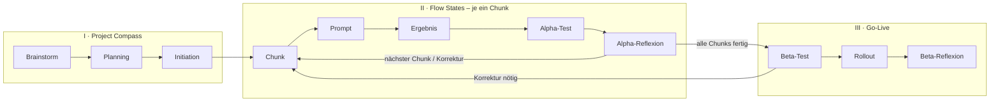

# IFCM-Prozessprotokoll – TrainerPro

Die Weiterentwicklung von TrainerPro folgt dem **Intelligence-Flow-Compass-Modell (IFCM)** aus der
Besonderen Lernleistung (Kap. 3.6–3.10). Dieser Ordner ist das vollständige, nachvollziehbare Protokoll
des Prozesses (Wert *Transparenz*). Geführt wird es von Claude als Protokollant über den Skill
[`.claude/skills/ifcm`](../../.claude/skills/ifcm/SKILL.md).

## Aktueller Stand

| | |
|---|---|
| **Phase** | I – Project Compass |
| **Sub-Phase** | I.1 Brainstorm (Entwurf aus der Arbeit übernommen, Bestätigung offen) |
| **Aktiver Chunk** | – |
| **Nächster Schritt** | Brainstorm-Entwurf prüfen und ergänzen, dann Planning freigeben |
| **Zuletzt aktualisiert** | 03.11.2026 |

## Phasenübersicht

| Phase | Sub-Phase | Dokument | Status |
|---|---|---|---|
| I Project Compass | Brainstorm | [01-brainstorm.md](01-brainstorm.md) | Entwurf |
| | Planning | [02-planning.md](02-planning.md) | Entwurf |
| | Initiation | [03-initiation.md](03-initiation.md), [chunks.md](chunks.md) | teilweise |
| II Flow States | je Chunk | [flow-states/](flow-states/) | offen |
| III Go-Live | Beta-Test, Rollout, Beta-Reflexion | 04-go-live.md (wird angelegt) | offen |

Chronologie aller Schritte: [protokoll.md](protokoll.md)

## Rollen (Solo-Projekt)

Alle vier Rollen – Compass Navigator, Coach, Developer, Guards – liegen bei einer Person.
Claude unterstützt jede Rolle und ist KI-Dokumentations-Agent/Protokollant; Entscheidungen trifft der Mensch.
